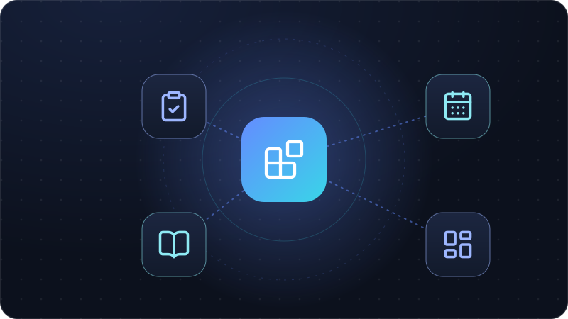
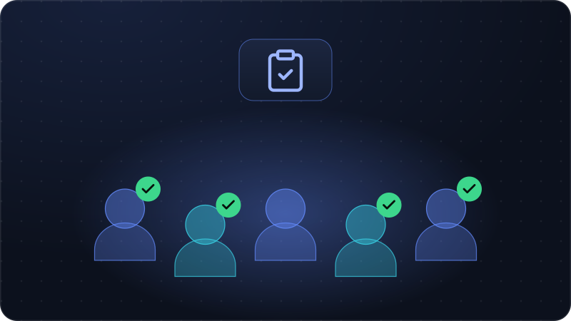
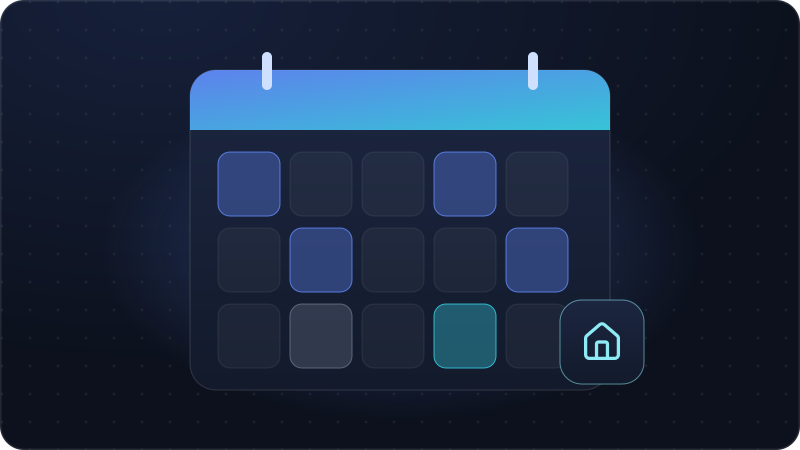
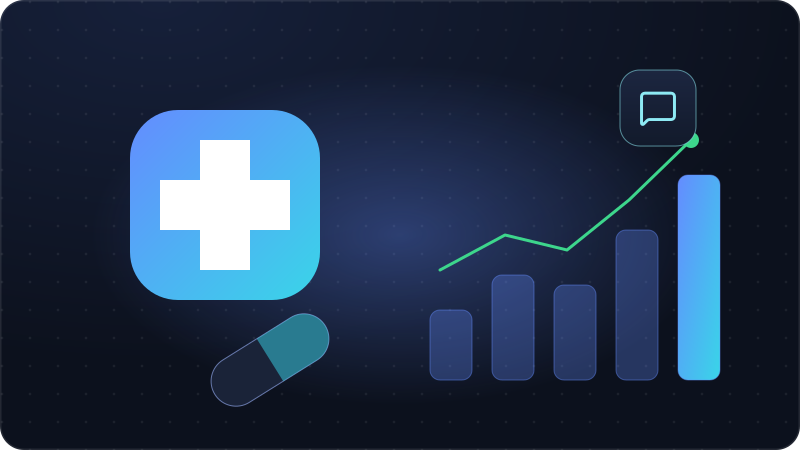

  

  

## Sobre mim

Sou de Porto Alegre e trabalho como representante comercial na **Hoya Vision Care**. Sou formado em **Análise e Desenvolvimento de Sistemas** e estagiei no CRECI-RS com PHP, MySQL e Bootstrap, em levantamento de requisitos, testes e documentação.

Nunca larguei a programação. Crio aplicativos para facilitar a minha rotina de vendas e estou à frente da TI da **Shalom Church**, minha igreja, onde construo o Nexo e coordeno a equipe que ajuda. Aprendo construindo.

Read in English

I'm based in Porto Alegre, Brazil, and work as a sales representative at **Hoya Vision Care**. I hold a degree in Systems Analysis and Development and previously interned at CRECI-RS with PHP, MySQL and Bootstrap. I keep building apps for my daily routine and lead IT at my church, where I build Nexo and coordinate the team that helps.

## Tecnologias

<table align="center">
  <tr>
    <th>Front-end</th>
    <th>Back-end</th>
    <th>Banco de dados</th>
    <th>Nuvem</th>
    <th>Ferramentas</th>
  </tr>
  <tr>
    <td align="center"></td>
    <td align="center"></td>
    <td align="center"></td>
    <td align="center"></td>
    <td align="center"></td>
  </tr>
</table>

## Projetos

> O código destes projetos é privado. As imagens são genéricas e representam cada app.

<table>
  <tr>
    <td valign="middle" width="50%">
      
    </td>
    <td valign="middle" width="50%">
      <h3>Nexo</h3>
      Projeto principal · Em uso  
      Ecossistema de apps da Shalom Church, com regras e código comuns. Criado por mim e pela equipe que coordeno.  
      <b>Módulos:</b> Portal, Discipulado, Agenda e Manual dos voluntários  
      <code>JavaScript</code> <code>React</code> <code>Supabase</code> <code>Vercel</code>
    </td>
  </tr>
  <tr>
    <td valign="top" width="50%">
      
      <h3>Discipulado</h3>
      Versão 4.0  
      Controle de presença e acompanhamento do discipulado, com níveis de acesso para líderes e administradores.  
      <code>React</code> <code>Supabase</code> <code>Vercel</code>
    </td>
    <td valign="top" width="50%">
      
      <h3>Agenda Shalom</h3>
      Arquivado, hoje faz parte do Nexo  
      Reserva dos espaços da igreja em uma agenda única.  
      <code>JavaScript</code>
    </td>
  </tr>
  <tr>
    <td valign="top" width="50%">
      
      <h3>Meus vouchers</h3>
      Em uso pessoal  
      Controle pessoal dos vouchers HOYA da minha rotina comercial.  
      <code>Next.js</code> <code>TypeScript</code> <code>Postgres</code> <code>Vercel</code>
    </td>
    <td valign="top" width="50%">
      
      <h3>Farma</h3>
      Privado  
      Fechamento mensal da farmácia: metas, comissões e mensagens.  
      <code>Next.js</code> <code>TypeScript</code> <code>Postgres</code>
    </td>
  </tr>
</table>

## Como eu trabalho

1. **Entendo o problema.** Ouço quem vai usar.
2. **Planejo.** Defino o essencial primeiro.
3. **Desenvolvo e testo.** Construo e testo no uso real.
4. **Evoluo.** Melhoro com o uso do dia a dia.

## Contato

  
  
  
  

  

